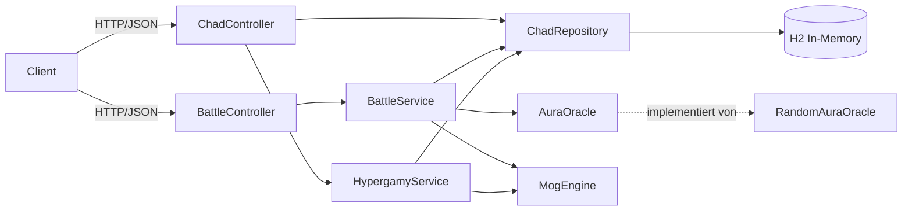

# MogBattle

Satirisches Mini-Spiel als REST-API: **fiktive** Charaktere ("Chads") treten gegeneinander an, die Engine entscheidet, wer wen "mogt". Dazu gibt es eine Hypergamy-Funktion, die für jeden Chad das nächstbessere "Upgrade" sucht.

> Das Projekt ist eine Parodie auf die Manosphere-Begriffe *Mogging* und *Hypergamy*. Es werden keine echten Personen bewertet, alle Charaktere sind erfunden.

Projekt im Modul M450 von Lazar und Dominik.

## Starten

```bash
./mvnw spring-boot:run      # API auf http://localhost:8080
./mvnw verify               # alle Tests + Reports
```

Die Weboberfläche läuft auf http://localhost:8080: Chads wählen, Battle starten, Leaderboard mit Hypergamy-Upgrade und Formular für neue Chads. Demo-Requests für die API liegen in [requests.http](requests.http).

| Methode | Pfad | Zweck |
|---|---|---|
| GET | `/api/chads` | alle Chads |
| POST | `/api/chads` | Chad anlegen (Stats 1-10, sonst 400) |
| POST | `/api/battles` | Battle `{"chadAId":1,"chadBId":2}` |
| GET | `/api/chads/{id}/upgrade` | Hypergamy: nächsthöherer Chad (404 wenn an der Spitze) |

### Spielregeln

- **MogScore** = Height×2 + Jawline×2 + Aura + Status + Frame (7 bis 70)
- Pro Battle gibt das `AuraOracle` jedem Chad zufällig 0-3 Bonuspunkte
- **Verdict** nach Abstand: `TIE` (0), `CLOSE_CALL` (1-4), `MOGGED` (5-14), `MEGAMOGGED` (ab 15)

## Planung

| Schritt | Branch | Inhalt |
|---|---|---|
| 1 | `main` | Spring-Boot-Grundgerüst |
| 2 | `feature/mog-engine` | MogEngine per TDD |
| 3 | `feature/ci-pipeline` | GitHub Actions, JaCoCo, Surefire-Report, Pages |
| 4 | `feature/battle-service` | AuraOracle, Repository, BattleService + Mock-Tests |
| 5 | `feature/chad-api` | REST-API, Validierung, Seed-Daten, Integrationstests |
| 6 | `feature/hypergamy` | Upgrade-Suche per TDD + Endpoint |
| 7 | `docs/readme` | Dokumentation, Präsentation |
| 8 | `feature/battle-ui` | Weboberfläche (HTML/CSS/JS) + Integrationstest |

Scope bewusst klein gehalten: wenige Features, dafür vollständig getestet.

## Architektur



- **MogEngine**: reine Spiellogik ohne Abhängigkeiten
- **AuraOracle**: Schnittstelle für den Zufall, wird in Tests gemockt
- **Services**: verbinden Repository, Orakel und Engine
- **Controller**: REST, Validierung, Fehler als `ProblemDetail` (404/400)

## Teststrategie

| Ebene | Klasse | Was | Mocks |
|---|---|---|---|
| Unit | `MogEngineTest` | Score, Verdict-Grenzwerte (4/5, 14/15) mit `@ParameterizedTest`, Battle-Regeln | keine |
| Unit | `BattleServiceTest` | Ablauf, Aura-Bonus, Fehlerfälle | `ChadRepository`, `AuraOracle` (Mockito) |
| Unit | `HypergamyServiceTest` | nächsthöherer Score, Gleichstand, Top-Chad | `ChadRepository` (Mockito) |
| Integration | `ChadControllerIT` | HTTP → Controller → Service → echte H2-DB, Validierung | keine |
| Integration | `BattleControllerIT` | kompletter Battle-Ablauf, 404/400 | nur `AuraOracle` (`@MockitoBean`) |
| Integration | `FrontendIT` | Startseite, JS und CSS werden ausgeliefert | keine |

- **Warum gemockt?** Das `AuraOracle` ist zufällig. Ohne Mock wären die Ergebnisse nicht reproduzierbar. Das Repository wird in den Unit-Tests gemockt, damit diese ohne Datenbank in Millisekunden laufen.
- **TDD**: `MogEngine` und `HypergamyService` wurden nach Red → Green → Refactor entwickelt. Jeder Schritt ist ein eigener Commit (`tdd red: ...`, `tdd green: ...`, `tdd refactor: ...`).
- **Reports**: `./mvnw verify` erzeugt
  - Testreport: `target/reports/surefire.html`
  - Coverage: `target/site/jacoco/index.html`

### Pipeline

[`.github/workflows/mog-battle.yml`](../../.github/workflows/mog-battle.yml) läuft bei jedem Push und PR auf dieses Projekt:

1. **build**: kompilieren
2. **test**: `mvn verify`, Testresultate und Coverage in der Job-Summary, Reports als Artifact
3. **deploy** (nur `main`): Reports auf GitHub Pages veröffentlichen

Reports online: https://dominiktbzzh.github.io/Modul-450-Lazar-und-Dominik/

## KI-Deklaration

KI (Claude Code) wurde als **Agent zur Code-Erstellung** eingesetzt: Grundgerüst, Implementierung, Tests, Pipeline und ein Entwurf dieser Dokumentation. Wir haben den Code gelesen, laufen lassen und können ihn erklären und selbständig weiterentwickeln. Fachliche Entscheide (Thema, Spielregeln, Umfang) kamen von uns.

## Reflexion

Wir hatten sehr viel spass beim implementieren. Wir haben gemerkt wie stark man AI nutzen kann aber man muss vorsichtig mit dem sein. Wir gaben diese Strikte Regeln aber die Grundstruktur und wie die Unittests sein sollten haben wir alles vorgegeben. Den Code haben wir auch mehrmals selbst durch reviewt. In Zukunft wird der Code an sich einen viel kleineren Wert haben, was wirklich Wert haben wird ist der Gedanke und die Architektur und das man diese selbst bestimmt.

### TDD

- Bei der `MogEngine` haben wir zuerst die Tests geschrieben. Dadurch waren die Regeln (Gewichtung, Verdict-Schwellen) schon vor dem Code genau festgelegt.
- Der Red-Schritt hat einen Fehler in den Testdaten aufgedeckt: Für "Mewing Max" stimmten die Stats nicht mit dem erwarteten Score überein (Commit `test: stats von mewing max ...`).
- Mit den grünen Tests konnten wir beim Refactor die Schwellen in Konstanten auslagern und `battle()` vereinfachen, ohne Angst, etwas kaputtzumachen.
- Für reine Logik ist TDD sehr angenehm, für Controller und Datenbank-Setup haben wir die Tests eher danach geschrieben.

### Code Reviews

## Fazit

Die Rubrikpunkte sind abgedeckt: Teststrategie, Unit-Tests, Integrationstests, Mocking, Reports und eine Pipeline mit Deploy auf `main`. Am meisten gebracht hat uns das Mocken des Zufalls: Erst damit liess sich ein Spiel überhaupt sinnvoll testen.
