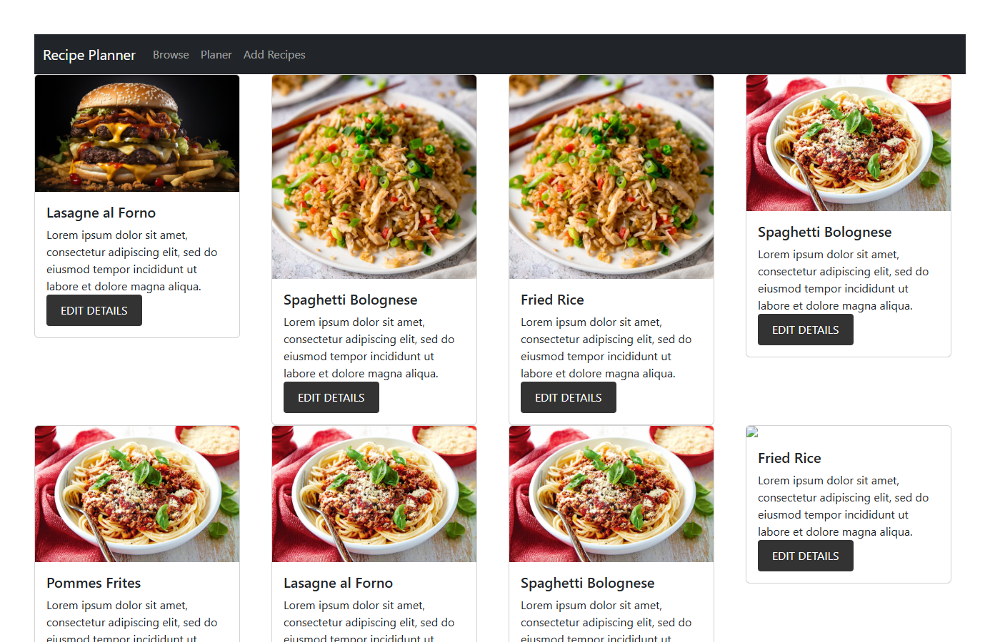
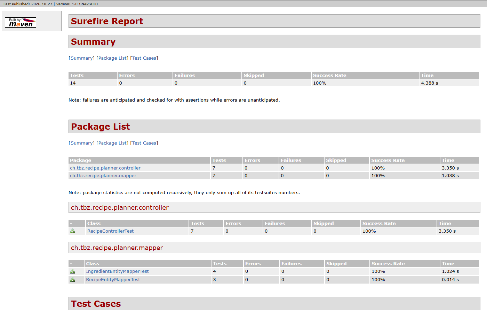
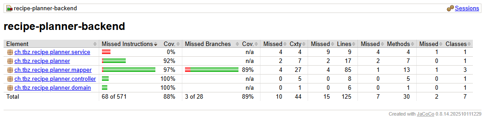
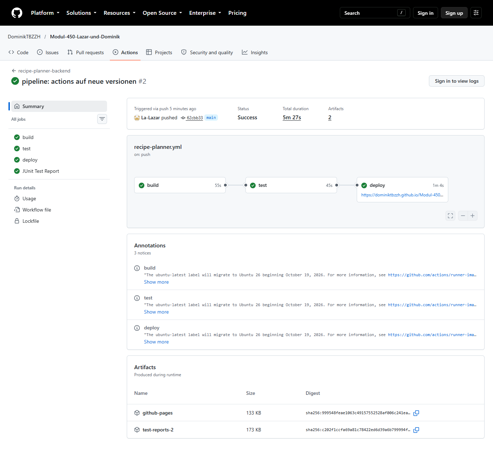
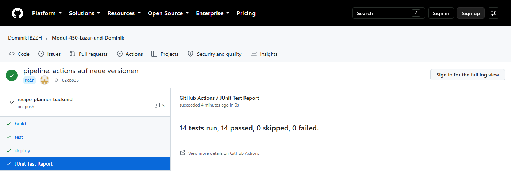

# CI/CD Pipelines – Recipe Planner

Lazar & Dominik, Modul 450

Projekt: [recipe-planner-backend](recipe-planner-backend), Frontend nur zum Anschauen: [recipe-planner-frontend](recipe-planner-frontend)

## Starten

Terminal im Ordner `recipe-planner-backend`:

```
.\mvnw.cmd verify            # Tests + Reports
.\mvnw.cmd spring-boot:run   # Server auf http://localhost:8080
```

Frontend: `npm install` und `npm start` im Ordner `recipe-planner-frontend`, läuft auf http://localhost:3000.



Mit Java 25 hat das Projekt zuerst nicht kompiliert. Im `pom.xml` haben wir Lombok (1.18.48) und
Byte Buddy (1.17.7) aktualisiert und Java auf 21 gesetzt.

## Aufgabe 1 – Unit Testing

**Controller** (`RecipeControllerTest`): Mit `@WebMvcTest` und MockMvc, Service und Mapper sind `@MockBean`.

| ID | Request | Erwartet |
|----|---------|----------|
| C-01 | `GET /api/recipes` | 200, alle Rezepte |
| C-02 | `GET /api/recipes` ohne Daten | 200, leere Liste |
| C-03 | `GET /api/recipes/recipe/{id}` | 200, Rezept mit Zutaten |
| C-04 | `GET /api/recipes/recipe/{id}` unbekannt | 200, leerer Body |
| C-05 | `GET /api/recipes/recipe/keine-uuid` | 400 |
| C-06 | `POST /api/recipes` | 200, gespeichertes Rezept |
| C-07 | `POST /api/recipes` ohne Body | 400 |

**Mapper** (`IngredientEntityMapperTest`, `RecipeEntityMapperTest`): Entity → Domain, Domain → Entity,
Listen und `null`. Alle Felder werden mit SoftAssertions geprüft.

**Vorteil SoftAssertions:** Ein normales `assertThat` hört beim ersten Fehler auf. SoftAssertions
prüfen alles und zeigen am Schluss alle Fehler zusammen. Ausprobiert: mit drei falschen Werten
kommt `Multiple Failures (3 failures)`.

## Aufgabe 2 – Reports

Im `pom.xml` sind Surefire, das Surefire-Report-Plugin und JaCoCo eingebaut. Bei `mvnw verify`
entstehen automatisch:

- `target/site/surefire-report.html` – Testresultate
- `target/site/jacoco/index.html` – Coverage





Der Service hat 0 %, weil die Aufgabe nur Controller und Mapper verlangt.

## Aufgabe 3 – Pipeline

Unser Repo ist auf GitHub, darum GitHub Actions: [`.github/workflows/recipe-planner.yml`](../.github/workflows/recipe-planner.yml).
Jeder Push aufs Backend startet die Pipeline.

| Job | Was passiert |
|-----|--------------|
| build | `mvnw compile` mit Java 21 |
| test | `mvnw verify`, Reports als Artifact `test-reports-<Nr>` |
| deploy | Reports auf GitHub Pages (nur `main`) |





Report vom letzten Lauf: https://dominiktbzzh.github.io/Modul-450-Lazar-und-Dominik/
